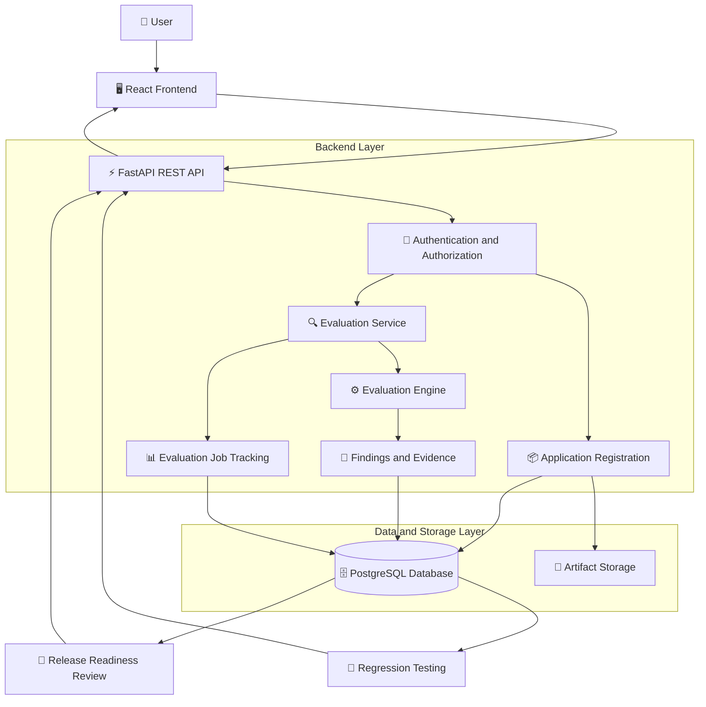
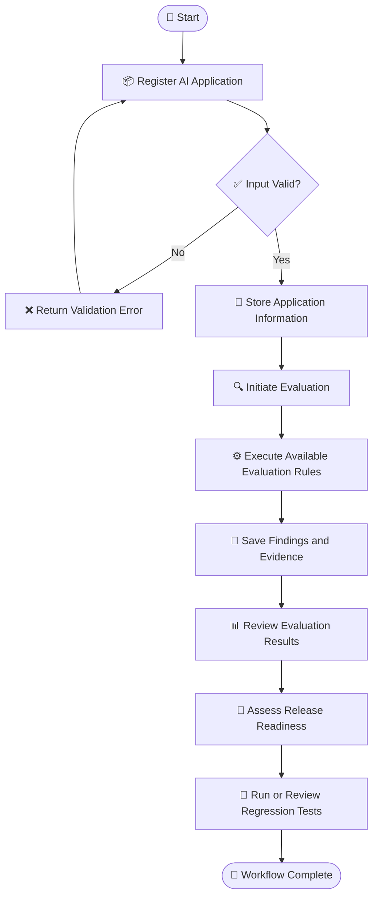

# 🛡️ QualiTrust AI
### AI Application Quality Engineering & Release Intelligence Platform

QualiTrust AI is a platform designed to help development teams evaluate AI applications, identify potential quality issues, track evaluation results, and assess release readiness.

It provides a centralized workflow for application registration, evaluation, findings management, and regression testing.

---

## 📌 Table of Contents

- [🚨 Problem Statement](#-problem-statement)
- [💡 Proposed Solution](#-proposed-solution)
- [🎯 Objectives](#-objectives)
- [✨ Key Features](#-key-features)
- [🏗️ System Architecture](#️-system-architecture)
- [🔄 Application Workflow](#-application-workflow)
- [🧰 Technology Stack](#-technology-stack)
- [🔐 Security](#-security)
- [🚀 Getting Started](#-getting-started)
- [🧪 Testing](#-testing)
- [🗺️ Future Enhancements](#️-future-enhancements)

---

## 🚨 Problem Statement

AI applications can produce inconsistent results, behave unexpectedly, and experience regressions when their code, configuration, or underlying models change.

Traditional testing workflows may not adequately address AI-specific quality risks. Evaluation results, identified issues, and supporting evidence can also become scattered across different tools and manual processes.

As a result, development teams may struggle to identify potential problems early, compare evaluation results, and determine whether an AI application is ready for release.

**The problem is the lack of a centralized workflow for evaluating AI application quality, tracking regressions, and supporting release decisions.**

## 💡 Proposed Solution

QualiTrust AI aims to provide a centralized platform for managing AI application quality evaluations.

Users can register applications through ZIP uploads or API targets. The backend processes evaluation requests, records findings and supporting evidence, and stores evaluation results for later review.

The platform also provides release-readiness reviews and regression testing to help teams understand evaluation outcomes and identify potential quality changes.

By bringing these activities together, QualiTrust AI aims to make AI application testing more organized, traceable, and consistent.

## 🎯 Objectives

- Provide a centralized place to register AI applications.
- Evaluate applications using the available evaluation engine.
- Record quality findings and supporting evidence.
- Track evaluation jobs and their results.
- Support structured release-readiness reviews.
- Compare evaluation outcomes to identify potential regressions.
- Protect application data through authentication and organisation-level access controls.

## ✨ Key Features

| Feature | Description |
|---|---|
| 📦 Application Registration | Register applications through ZIP uploads or API targets. |
| 🔍 Application Evaluation | Run the available evaluation engine against registered applications. |
| 🧾 Findings and Evidence | Store identified issues and their supporting evidence. |
| 📊 Evaluation Tracking | Track evaluation jobs and retrieve their results. |
| 🚦 Release Readiness | Review evaluation outcomes to support release decisions. |
| 🔄 Regression Testing | Compare evaluation outcomes to identify potential regressions. |
| 🔐 Authentication | Authenticate users using JWT-based mechanisms. |
| 👥 Role-Based Access | Restrict actions according to user roles and permissions. |
| 🏢 Organisation Isolation | Restrict organisation users to their permitted data. |
| 🗄️ Persistent Storage | Store application and evaluation metadata in PostgreSQL. |

*Note: Feature availability depends on the current implementation and configuration.*

## 🏗️ System Architecture

The following diagram illustrates the platform's high-level architecture.



### Architecture Overview

1. **Frontend:** Provides the user interface for interacting with the platform.
2. **FastAPI Backend:** Receives requests and coordinates application operations.
3. **Authentication and Authorization:** Validates users and enforces access permissions.
4. **Evaluation Service:** Coordinates the evaluation process.
5. **Evaluation Engine:** Analyses applications using the implemented evaluation logic.
6. **Database:** Stores application metadata, evaluation records, findings, and related information.
7. **Artifact Storage:** Stores application files where supported.
8. **Release and Regression Modules:** Help users review evaluation outcomes and identify potential regressions.

## 🔄 Application Workflow

The following diagram shows the intended application lifecycle.



### Workflow Explanation

1. **Registration:** The user registers an application using a ZIP file or API target.
2. **Validation:** The backend validates the submitted information.
3. **Storage:** Application information and required artifacts are stored.
4. **Evaluation:** An evaluation job is initiated.
5. **Analysis:** The available evaluation engine processes the application.
6. **Results:** Findings and evidence are recorded.
7. **Review:** Users examine the evaluation results.
8. **Release Assessment:** Evaluation outcomes support a release-readiness review.
9. **Regression Testing:** Users can compare evaluation outcomes to identify potential changes.

Release approval is not automatic merely because an evaluation finishes; it depends on the platform's implemented release criteria and review process.

## 🧰 Technology Stack

| Layer | Technology | Purpose |
|---|---|---|
| Frontend | React | User interface |
| Frontend Language | TypeScript | Type-safe frontend development |
| Frontend Build Tool | Vite | Development server and build tooling |
| Styling | Tailwind CSS | Interface styling |
| Backend Language | Python | Backend implementation |
| Backend Framework | FastAPI | REST API development |
| Data Validation | Pydantic | Request and response validation |
| ORM | SQLAlchemy | Database interaction |
| Database Migrations | Alembic | Schema version management |
| Database | Supabase PostgreSQL | Persistent relational data storage |
| Authentication | JWT | Token-based authentication |
| Artifact Storage | Local / Supabase Storage | Application artifact storage, where configured |

## 🔐 Security

QualiTrust AI incorporates security mechanisms intended to protect application data and control access.

- **JWT Authentication:** Supports authenticated API access.
- **Role-Based Access Control:** Restricts operations according to user permissions.
- **Organisation-Level Isolation:** Helps prevent users from accessing unauthorised organisation data.
- **Input Validation:** Validates incoming requests.
- **Upload Validation:** Applies checks to uploaded application files.
- **Environment Configuration:** Keeps deployment-specific settings outside application source code.

Security controls should be verified against the current implementation before the system is deployed to production.

## 🚀 Getting Started

### Prerequisites

Install the tools required by the project:

- Python version specified by the backend configuration.
- Node.js version compatible with the frontend.
- npm or the package manager used by the project.
- Access to a configured PostgreSQL database.
- Git.

### 1. Clone the Repository

```bash
git clone https://github.com/Thiyanesh07/TCS_AI.git
cd TCS_AI
```

Navigate to the actual QualiTrust AI project directory if it is stored in a subfolder.

### 2. Set Up the Backend

Open a terminal in the backend directory.

Create a virtual environment:

```bash
python -m venv .venv
```

Activate it on Windows:

```powershell
.\.venv\Scripts\Activate.ps1
```

Install the dependencies:

```bash
pip install -r requirements.txt
```

Create a local `.env` file using the project's `.env.example` as a guide. Configure the database URL and other required settings.

**Never commit your real `.env` file or credentials.**

### 3. Configure the Database

Ensure the database settings are correct before starting the application.

If the project uses Alembic, apply migrations only after verifying the target database and obtaining the required approval:

```bash
alembic upgrade head
```

### 4. Start the Backend

From the backend directory, run:

```bash
python -m uvicorn app.main:app --reload
```

The command assumes the application entry point is `app/main.py`. Adjust it if the actual project structure differs.

### 5. Open the API Documentation

When the backend is running, open:

`http://127.0.0.1:8000/docs`

The OpenAPI specification is generally available at:

`http://127.0.0.1:8000/openapi.json`

### 6. Start the Frontend

Open another terminal in the frontend directory.

Install dependencies:

```bash
npm install
```

Start the development server:

```bash
npm run dev
```

Use the local URL printed by Vite.

Ensure that the frontend API base URL points to the running backend and that the backend CORS configuration permits the frontend origin.

*Check the project's actual directory structure, environment variable names, and scripts before following these commands.*

## 🧪 Testing

Run the backend tests using the test framework configured by the project. For a pytest-based project, the command is typically:

```bash
pytest
```

For the frontend, use the scripts defined in its `package.json`. For example, if configured:

```bash
npm run build
```

Testing should cover authentication, permissions, application registration, evaluation, findings retrieval, release-readiness reviews, and regression workflows.

Actual test results should be documented only after the tests have been executed.

## 🗺️ Future Enhancements

Potential improvements include:

- 🤖 Advanced AI-based evaluation methods.
- 📈 More detailed evaluation metrics and analytics.
- 🔬 Expanded quality and safety test coverage.
- 🔄 Enhanced regression comparison and reporting.
- 📋 More detailed release-readiness reports.
- ⚙️ Durable background job processing.
- 📊 Improved evaluation dashboards.
- 🔔 Notifications for evaluation failures and release risks.

These are potential future improvements, not claims that the features are already implemented.

## 🎯 Expected Impact

QualiTrust AI aims to help development teams organise AI application evaluations, maintain traceable findings, identify potential regressions, and make better-informed release decisions.

By bringing these workflows into one platform, it seeks to improve visibility into AI application quality and make evaluation results easier to review.

---

### 🛡️ QualiTrust AI
**Evaluate quality. Track regressions. Make informed release decisions.**
