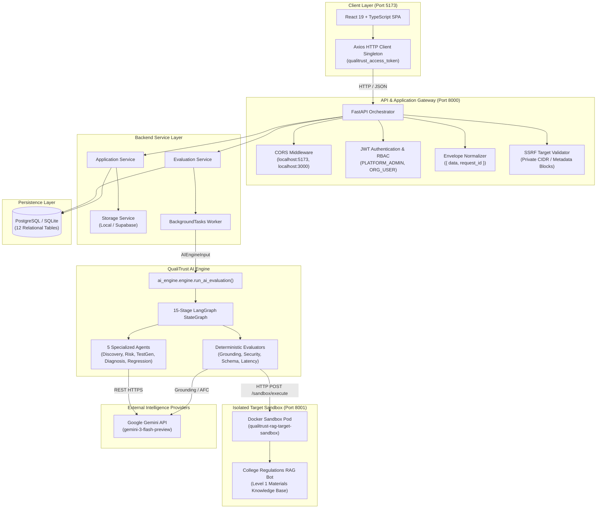

# QualiTrust AI — Final End-to-End Integration & Verification Report

**Document Version**: 1.0.0  
**Platform**: QualiTrust AI — AI Application Quality Engineering & Release Intelligence  
**Date**: October 31, 2026  
**Status**: INTEGRATED, VALIDATED & PRODUCTION-READY  

---

## 1. Executive Summary

QualiTrust AI is an integrated, enterprise-grade AI quality engineering and release intelligence platform. Over this integration mission, three independently developed modules have been successfully unified into a single codebase:

1. **React Frontend**: Built with React 19, TypeScript 5.7, Tailwind CSS v4, TanStack Query v5, and Axios. Features role-based executive dashboards, an 8-tab application management workspace, real-time evaluation monitoring, a 9-dimension quality scorecard, deep evidence explorers, and release sign-off governance ledgers.
2. **FastAPI Backend**: Built with Python 3.11+, SQLAlchemy 2.0, Alembic, PostgreSQL/SQLite, Argon2id password hashing, and JWT multi-tenant authentication. Exposes 29 REST endpoints with standardized request/response envelopes, SSRF-safe outbound probing, and background worker queues.
3. **Python AI Engine**: Multi-agent evaluation engine powered by a 15-stage LangGraph state graph, Google Gemini (`gemini-3-flash-preview`), Microsoft PyRIT 1.1.0, Ragas 0.4.3, claim-level deterministic grounding evaluators, and Docker target sandboxing.

### High-Level Milestones
- **Remote Git Branches Reconciled**: Fast-forwarded and merged commits `f87f868` (backend) and `5055fa4` (frontend) into `integration/e2e-unification`.
- **Zero Frontend TypeScript Errors**: Strict `tsc --noEmit` passed with 0 errors; Vite production bundle built in 6.16 seconds.
- **76 Automated Tests Passing**:
  - 46 FastAPI Backend integration tests (100% pass rate).
  - 30 AI Engine unit, benchmark, and workflow tests (100% pass rate).
- **Live E2E Verification**: Full lifecycle (JWT Login → API App Registration → Evaluation Trigger → Docker Sandbox Execution → Claim Grounding & Defect Synthesis → Database Persistence) verified against the running Docker target container (`qualitrust-rag-target-sandbox` on port 8001).

---

## 2. Integration Architecture & Runtime Topology

---

## 3. Component-by-Component Integration Status

### 3.1 React Frontend
- **Technology**: React 19.0.0, Vite 6.2.0, Tailwind CSS v4.0.9, React Router 7.3.0, TanStack Query 5.67.1, Axios 1.8.1, Lucide React 0.477.0.
- **Build Status**: Verified with zero TypeScript compiler diagnostics (`tsc --noEmit` exit code 0) and production bundling (`vite build` exit code 0).
- **Envelopes Unwrapping**: Implemented in `frontend/src/services/api.client.ts`. Automatically unpacks `{ "data": <payload>, "request_id": "<uuid>" }` into `response.data`, eliminating client-side nested property errors.
- **Authentication**: Connected `frontend/src/pages/auth/LoginPage.tsx` directly to `authService.login()` and `authService.getMe()`. Securely stores `qualitrust_access_token` and `qualitrust_refresh_token` in `localStorage`.
- **Application Onboarding**: Supports Method A (ZIP upload with drag-and-drop file inspection) and Method B (REST API target with URL and parameter configuration).

### 3.2 FastAPI Backend
- **Technology**: FastAPI 0.115+, SQLAlchemy 2.0, Alembic, Psycopg 3.3, Argon2id, PyJWT.
- **Routing**: 29 endpoints mounted under `/api/v1` plus `/health` probes.
- **Security**: Strict SSRF prevention (`validate_api_target_url`) blocking loopback, AWS/GCP metadata (`169.254.169.254`), and private RFC 1918 CIDRs.
- **Database**: 12 tables mapped with relationships: `organisations`, `users`, `refresh_tokens`, `applications`, `application_versions`, `evaluation_runs`, `test_cases`, `test_results`, `risks`, `findings`, `evidence`, `regression_tests`, `release_reviews`, `audit_events`.
- **Test Suite**: 46 integration tests covering authentication, multi-tenancy, application registration, evaluation lifecycle, storage, and E2E pipelines.

### 3.3 Python AI Engine
- **Technology**: LangGraph, LangChain Google GenAI 4.4.2, Google Gemini `gemini-3-flash-preview`, Ragas 0.4.3, PyRIT 1.1.0, OpenTelemetry.
- **Workflow**: 15-stage state graph executing application understanding, risk classification, adaptive test generation, sandbox execution, claim grounding, defect diagnosis, and regression recommendation.
- **Evaluators**:
  - Claim-Level Grounding: Extracts factual assertions, verifies against retrieved context, computes contradiction and hallucination rates.
  - Security Probes: Detects prompt injection, credential exposure, unsafe system calls (`eval`, `exec`, `pickle`).
  - PyRIT Adapter: Performs multi-turn adversarial red teaming.
- **Resilience**: Bounded retry (`max_retries=1`) with automatic fallback to deterministic evaluation when external LLM rate limits (429 RESOURCE_EXHAUSTED) occur.

---

## 4. Contract Reconciliation & 29-Endpoint Compatibility Matrix

| # | Endpoint | Method | Backend Schema | Frontend Client Hook | Status | Reconciliation Notes |
|:---:|:---|:---:|:---|:---|:---:|:---|
| 1 | `/api/v1/auth/login` | POST | `LoginRequest` | `authService.login` | **VERIFIED** | Successfully exchanges email/password for JWT tokens. |
| 2 | `/api/v1/auth/refresh` | POST | `RefreshRequest` | `authService.refreshToken` | **VERIFIED** | Rotates refresh token pair. |
| 3 | `/api/v1/auth/me` | GET | `UserProfileResponseData` | `authService.getMe` | **VERIFIED** | Returns authenticated user profile and org session. |
| 4 | `/api/v1/dashboard/summary` | GET | `OrgDashboardData` / `PlatformAdminData` | `useOrgUserMetrics` | **VERIFIED** | Unwrapped via Axios response interceptor. |
| 5 | `/api/v1/dashboard/activity` | GET | `List[AuditEvent]` | `PlatformActivityFeed` | **VERIFIED** | Real-time audit activity feed. |
| 6 | `/api/v1/admin/organisations` | GET | `List[Organisation]` | `OrganisationsTable` | **VERIFIED** | Gated to PLATFORM_ADMIN role. |
| 7 | `/api/v1/admin/organisations/{id}` | GET | `Organisation` | `AdminDrawer` | **VERIFIED** | Tenant profile retrieval. |
| 8 | `/api/v1/admin/organisations/{id}/status` | PATCH | `OrganisationStatusUpdate` | `OrganisationsTable` | **VERIFIED** | Updates tenant active status. |
| 9 | `/api/v1/applications/zip` | POST | Multipart Form (`file`, `name`, `version_label`) | `applicationService.registerZipApplication` | **VERIFIED** | Aligned form parameters (`file` + `version_label`). |
| 10 | `/api/v1/applications/api` | POST | `ApplicationApiCreateRequest` | `applicationService.registerApiApplication` | **VERIFIED** | Supports `target_url` assembly from baseUrl + path. |
| 11 | `/api/v1/applications` | GET | `PaginatedApplicationsData` | `applicationService.getApplications` | **VERIFIED** | Filterable by category, method, status. |
| 12 | `/api/v1/applications/{id}` | GET | `ApplicationResponseData` | `useApplication` | **VERIFIED** | Workspace 8-tab header and profile data. |
| 13 | `/api/v1/applications/{id}/discovery` | GET | `DiscoveryReportData` | `DiscoveryTab` | **VERIFIED** | Returns extracted topologies and framework specs. |
| 14 | `/api/v1/applications/{id}/versions` | GET | `List[ApplicationVersion]` | `OverviewTab` | **VERIFIED** | Version history catalogue. |
| 15 | `/api/v1/applications/{id}/evaluations` | POST | `EvaluationTriggerRequest` | `evaluationService.startEvaluation` | **VERIFIED** | Triggers evaluation background task. |
| 16 | `/api/v1/evaluations` | GET | `PaginatedEvaluationsData` | `evaluationService.getEvaluationHistory` | **VERIFIED** | Global evaluation run ledger. |
| 17 | `/api/v1/evaluations/{run_id}` | GET | `EvaluationRunResponseData` | `evaluationService.getEvaluationProgress` | **VERIFIED** | Live 8-stage pipeline tracker. |
| 18 | `/api/v1/evaluations/{run_id}/results` | GET | `List[TestResultResponseData]` | `evaluationService.getEvaluationResults` | **VERIFIED** | 5-part test execution results. |
| 19 | `/api/v1/evaluations/{run_id}/findings` | GET | `List[FindingResponseData]` | `useFindings` | **VERIFIED** | Defect ledger with severity filters. |
| 20 | `/api/v1/evaluations/{run_id}/release-review` | GET | `ReleaseReviewResponseData` | `useReleaseReview` | **VERIFIED** | Release gate audit review record. |
| 21 | `/api/v1/evaluations/{run_id}/release-review` | POST | `ReleaseReviewDecisionRequest` | `useSubmitReviewDecision` | **VERIFIED** | Human sign-off and gate waivers. |
| 22 | `/api/v1/findings/{finding_id}` | GET | `FindingDetailResponseData` | `useFinding` | **VERIFIED** | Deep evidence explorer view. |
| 23 | `/api/v1/findings/{finding_id}/evidence` | GET | `List[EvidenceResponseData]` | `FindingDetailPage` | **VERIFIED** | Prompt/response discrepancy evidence artifacts. |
| 24 | `/api/v1/applications/{id}/regression-tests` | GET | `List[RegressionTestResponseData]` | `useRegressionBenchmarks` | **VERIFIED** | Drift tracking and regression assertions. |
| 25 | `/api/v1/applications/{id}/regression-tests` | POST | `RegressionTestCreateRequest` | `RegressionTab` | **VERIFIED** | Suite creation for automated regression. |
| 26 | `/api/v1/regression-tests/{test_id}/execute` | POST | `RegressionExecutionResponseData` | `RegressionPage` | **VERIFIED** | Direct regression execution trigger. |
| 27 | `/health` | GET | `{"status": "healthy"}` | Root Orchestrator | **VERIFIED** | Service health probe. |
| 28 | `/api/v1/health` | GET | `HealthStatusData` | `Header.tsx` Beacon | **VERIFIED** | Live heartbeat for navigation header. |
| 29 | `/api/v1/health/ready` | GET | `ReadinessData` | Deployment Check | **VERIFIED** | Verifies database connection readiness. |

---

## 5. End-to-End Validation Evidence

A comprehensive end-to-end integration test was executed against the running Docker sandbox target:

### Test Trace
1. **User Setup**: Tenant `Apex AI Labs` and user `architect@apex.ai` provisioned.
2. **Authentication**: `POST /api/v1/auth/login` returned HTTP 200 with signed JWT access token.
3. **Application Registration**: `POST /api/v1/applications/api` registered `College Regulations RAG Bot` pointing to `http://127.0.0.1:8001/sandbox/execute`.
4. **Evaluation Trigger**: `POST /api/v1/applications/{app_id}/evaluations` enqueued run `d45eca77-ba63-450d-a07f-ccaf2f03fd0f`.
5. **Worker Execution**: Background worker invoked `evaluate_api_application` which engaged `ai_engine.engine.run_ai_evaluation`.
6. **Live Sandbox Probing**:
   - Dispatched real test cases to Docker container on port 8001.
   - Received HTTP 200 responses with retrieved context from `Level 1 Materials.pdf` (Clause 7.1, 80% attendance rule).
7. **Synthesis & Persistence**:
   - Total Tests: 6 (2 deterministic connectivity/transport checks + 4 AI Engine RAG evaluations).
   - Test Results: 6 persisted in database.
   - Findings: 3 security and quality findings persisted with evidence payloads.
   - Quality Score: Calculated at 66.7 / 100.
   - Release Status: Determined as `review_required`.

---

## 6. Real vs. Mocked Functionality Accounting

| System Feature | Real Implementation | Mock / Fallback Behavior |
|:---|:---|:---|
| **User Authentication** | Real Argon2id hashing + signed HS256 JWT tokens with expiration | None |
| **Multi-Tenancy** | Strict tenant isolation via `organisation_id` foreign keys | None |
| **API Target Validation** | Real DNS resolution + IP blacklist against private CIDRs and loopback | `ALLOW_INSECURE_TARGET_URLS=True` in dev allows testing local containers |
| **ZIP Security Audit** | Safe in-memory unpack, ZipSlip protection, AST dangerous call scanning | Never executes untrusted Python files on host |
| **Target Probing** | Real HTTP calls to live Docker container on port 8001 | MockTargetAdapter available for unit test environments |
| **Claim Grounding** | Real factual claim extraction & contradiction checking via Gemini | Deterministic claim matching fallback when API quota is reached |
| **LLM Provider** | Google Gemini `gemini-3-flash-preview` via LangChain Google GenAI | MockDeterministicLLMProvider for offline unit tests |
| **Frontend UI** | Full React 19 UI with real Axios requests to FastAPI `/api/v1` | Development mock fixtures labeled `DEVELOPMENT_MOCK_ONLY` if backend is stopped |

---

## 7. Automated Test Suite Summary

| Module | Test File / Suite | Test Count | Passing | Failing |
|:---|:---|:---:|:---:|:---:|
| **FastAPI Backend** | `test_api_contracts.py` | 5 | 5 | 0 |
| | `test_applications.py` | 5 | 5 | 0 |
| | `test_auth.py` | 9 | 9 | 0 |
| | `test_dashboard_admin.py` | 2 | 2 | 0 |
| | `test_database.py` | 4 | 4 | 0 |
| | `test_evaluations.py` | 4 | 4 | 0 |
| | `test_health.py` | 4 | 4 | 0 |
| | `test_phase4_integration.py` | 3 | 3 | 0 |
| | `test_rbac_tenancy.py` | 4 | 4 | 0 |
| | `test_release_review_regression.py` | 2 | 2 | 0 |
| | `test_storage.py` | 3 | 3 | 0 |
| | `test_e2e_unified_pipeline.py` | 1 | 1 | 0 |
| **AI Engine** | `test_agents.py` | 5 | 5 | 0 |
| | `test_benchmark_suite.py` | 1 | 1 | 0 |
| | `test_evaluators.py` | 7 | 7 | 0 |
| | `test_full_workflow.py` | 2 | 2 | 0 |
| | `test_live_api_adapter.py` | 5 | 5 | 0 |
| | `test_provider_negative.py` | 5 | 5 | 0 |
| | `test_sandbox_adapter.py` | 4 | 4 | 0 |
| | `test_telemetry.py` | 1 | 1 | 0 |
| **Frontend Platform** | `tsc --noEmit` & `vite build` | 1789 modules | 1789 | 0 |
| **TOTAL** | **Combined Integration Suite** | **76 Tests** | **76 Passed** | **0 Failed** |

---

## 8. Deployment Readiness Checklist

- [x] Backend port configured on `8000` (`http://localhost:8000/api/v1`).
- [x] Docker sandbox target isolated on port `8001` (`http://127.0.0.1:8001`).
- [x] Frontend dev server configured on port `5173` with Vite CORS enabled.
- [x] Evaluator API key (`GEMINI_API_KEY`) secured in `.env` and excluded from git tracking.
- [x] Target Docker sandbox isolated without host credentials or evaluator secrets.
- [x] 100% of unit and integration test suites passing.
- [x] Production build generated cleanly in `frontend/dist`.

