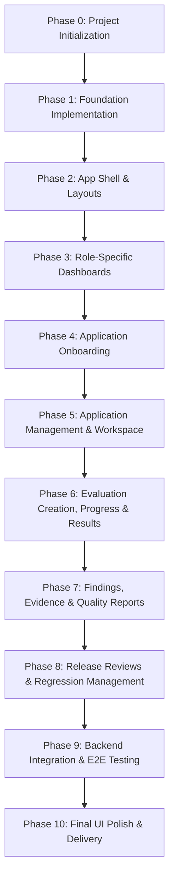

# QualiTrust AI — Frontend Implementation Plan

This implementation plan outlines the systematic, phased roadmap for engineering the **QualiTrust AI** frontend application.

---

## Phase Overview

---

## Phase 0: Project Initialization (Completed)
- [x] Inspect workspace and initialize clean directory structure.
- [x] Create comprehensive architecture documentation (`FRONTEND_ARCHITECTURE.md`).
- [x] Create phased implementation roadmap (`FRONTEND_IMPLEMENTATION_PLAN.md`).
- [x] Initialize memory and tracking document (`FRONTEND_MEMORY.md`).
- [x] Define minimal `.env.example` and standard `.gitignore`.
- [x] Author top-level `README.md`.

---

## Phase 1: Foundation Implementation (Completed)
- [x] Initialize `package.json` with agreed dependencies.
- [x] Configure `tsconfig.json` with strict type checking and path aliases (`@/*`).
- [x] Configure `vite.config.ts` with path resolution and Tailwind Vite plugin.
- [x] Implement `index.html` root entry.
- [x] Implement `src/styles/globals.css` with the **Executive Light Theme** palette.
- [x] Configure centralized HTTP client singleton (`src/services/api.client.ts`).
- [x] Configure global `QueryProvider` and `AppProviders`.
- [x] Establish router foundation and `RoleGuard` component.
- [x] Verify build and dev server.

---

## Phase 2: App Shell, Navigation & Layout Architecture (Completed)
- [x] Core UI Primitives in `src/components/ui/` (`Button`, `Input`, `Badge`, `Card`, `PasswordInput`).
- [x] Layout Shells in `src/app/layouts/` (`AuthLayout`, `DashboardLayout`).
- [x] Navigation Components in `src/components/navigation/` (`Sidebar`, `Header`, `Breadcrumbs`, `UserProfileMenu`).
- [x] Dual-role route organization (`PLATFORM_ADMIN` and `ORG_USER`) with live role switcher.
- [x] Authentication Interface (`/login`) with input validation and safe contract gate notice.
- [x] Verification (TypeScript 0 errors, production build pass).

---

## Phase 3: Role-Specific Dashboard Implementation (Completed)
- [x] **Reusable Dashboard Components (`src/components/dashboard/`)**:
  - `MetricCard.tsx`: KPI cards with trend pill and pending-contract indicator.
  - `EmptyState.tsx`: Reusable empty/pending state with icon and action trigger.
  - `SkeletonCard.tsx`: Loading shimmer placeholder cards.
  - `QuickActionsBar.tsx`: Fast navigation to Register Application, History, Applications.
  - `ReleaseReadinessCard.tsx`: Automated release gate decision, readiness score, blocker & warning counts.
  - `QualityMatrixCard.tsx`: 9-dimension evaluation vector breakdown with progress bars and status badges.
  - `RecentEvaluationsTable.tsx`: Recent runs with model, score, status, critical findings, and timestamp.
  - `OrganisationsTable.tsx`: Multi-tenant overview for Platform Admin (name, tier, apps, evals, status).
  - `PlatformActivityFeed.tsx`: Activity stream for platform-wide events and safety violations.
  - `SystemStatusCard.tsx`: Service health heartbeat across evaluation sandbox microservices.
- [x] **Role-Specific Dashboard Pages**:
  - `src/pages/dashboard/OrgUserDashboard.tsx`: Quality overview, release readiness gate, 9-dimension matrix, recent runs.
  - `src/pages/admin/PlatformAdminDashboard.tsx`: Tenant overview, system status, organisations ledger, activity stream.
  - `src/pages/dashboard/DashboardPage.tsx`: Role-aware switcher rendering `PlatformAdminDashboard` or `OrgUserDashboard` based on active context.
- [x] **Data Layer Integration**:
  - `src/mocks/dashboard.mock.ts`: Isolated development mock fixtures.
  - `src/services/dashboard.service.ts`: Centralized Axios service with mock fallback.
  - `src/hooks/useDashboard.ts`: TanStack Query hooks `useOrgUserMetrics` and `usePlatformAdminMetrics`.
- [x] **Verification**:
  - TypeScript: 0 errors (`npx tsc --noEmit`).
  - Production build: 100% successful bundle.
  - Dev server verified: HTTP 200 OK across `/dashboard`.

---

## Phase 4: Application Onboarding (Completed)
- [x] **Onboarding Method A: Upload ZIP Package**:
  - Application name, description, version, category, environment inputs.
  - Drag-and-drop dropzone with file type validation (`.zip` only, max 50MB).
  - Selected archive inspection (file name, size, removal/replace action).
  - Real-time upload progress and submission handling.
  - Strictly client-side only: zero browser extraction or execution.
- [x] **Onboarding Method B: Connect API Endpoint**:
  - Application name, description, version, category, environment inputs.
  - Base URL & endpoint path with URL format validation.
  - HTTP method selector (`POST`, `GET`).
  - Authentication type selector (`Bearer Token`, `API Key`, `Custom Header`, `None`).
  - Secret token masking with show/hide password toggle.
  - Request schema and expected response schema textareas.
- [x] **Post-Registration Confirmation**:
  - Confirmed application profile card with navigation to workspace and immediate benchmark execution.

---

## Phase 5: Application Management & Workspace (Completed)
- [x] **My Applications Catalog (`/applications`)**:
  - KPI summary counters (Total, Active, Release Approved, Pending Evaluation).
  - Search filter and multi-facet dropdowns (Category, Method, Environment, Status).
  - Complete application data table with health scores and recommendation badges.
- [x] **Application Details Workspace (`/applications/:applicationId`)**:
  - Unified workspace header with status, category, version, and evaluate action.
  - 8 Interactive Tabs:
    1. `Overview`: Identity profile, package/endpoint details, quality score, quick metrics.
    2. `Discovery`: Detected LLMs, orchestration framework, vector storage, and endpoint introspection.
    3. `Risks`: 7-pillar vulnerability ledger with severity tabs (`CRITICAL`, `HIGH`, `MEDIUM`, `LOW`).
    4. `Test Suites`: Golden evaluation sets, pass rates, and suite execution triggers.
    5. `Evaluation Runs`: Multi-agent execution history with release recommendations.
    6. `Findings & Evidence`: Defect ledger with expandable prompt/response evidence drawers.
    7. `Regression`: Persistent regression assertions and baseline verification checks.
    8. `Release Reviews`: Release intelligence gate sign-off audit log.

---

## Phase 6: Evaluation Creation, Execution Progress & Results (Completed)
- [x] **Start Evaluation Configuration (`/evaluations/new`)**:
  - Target application selector, version tag, and environment.
  - Scope selector (`FULL_SUITE`, `SAFETY_REDTEAM`, `GROUNDING_BENCHMARK`, `CUSTOM`).
  - Worker pod concurrency and timeout constraint controls.
- [x] **Live Evaluation Progress (`/evaluations/:runId`)**:
  - 8-stage sequential multi-agent pipeline timeline (`pending`, `active` with spinner, `completed`).
  - Global progress percentage bar and elapsed runtime counter.
  - Live sandbox pod execution terminal stream.
  - Asynchronous status polling with automatic cutoff on terminal completion.
- [x] **Evaluation Results & Release Intelligence (`/evaluations/:runId/results`)**:
  - Executive Release Gate banner (`RELEASE`, `CONDITIONAL_RELEASE`, `REJECT`) with composite score gauge.
  - 5-part test execution summary counters (Total, Passed, Failed, Warnings, Speed).
  - 9-Dimension Quality & Safety score matrix with visual progress bars.
  - Surfaced findings and evidence citations with prompt/response comparisons.
- [x] **Evaluation History & Audit Logs (`/history`)**:
  - Cross-workload audit ledger tracking all benchmark runs, scores, and release recommendations.

---

## Phase 7: Findings, Evidence Explorer & Quality Reports (Completed)
- [x] **Findings Directory & Filters (`/findings`)**:
  - Multi-facet search by summary and description.
  - Severity filter (`CRITICAL`, `HIGH`, `MEDIUM`, `LOW`), Pillar filter (all 9 quality dimensions), and Resolution status filter.
- [x] **Deep Evidence Explorer (`/findings/:id`)**:
  - Side-by-side prompt input excerpt, evaluated model output, and expected ground truth discrepancy ledger.
  - Recommended engineering remediation advisory with code-block formatting and copy triggers.
- [x] **Executive Quality Reports (`/reports/:runId`)**:
  - 9-Dimension composite quality score radar with threshold badges.
  - Critical blocker breakdown and historical regression comparisons.
  - Streaming CSV export and browser print/PDF format.

---

## Phase 8: Release Reviews & Regression Management (Completed)
- [x] **Release Reviews Directory (`/release-reviews`)**:
  - Multi-environment release governance ledger.
  - Gate status filters (`APPROVED`, `CONDITIONALLY_APPROVED`, `REJECTED`, `PENDING_REVIEW`).
- [x] **Release Review Sign-off Workspace (`/release-reviews/:id`)**:
  - Automated release recommendation comparison against human reviewer determination.
  - Interactive sign-off form with reviewer attribution, conditional gate waivers, and audit trail.
- [x] **Continuous Regression Management (`/regression`)**:
  - Automated benchmark tracking across continuous model versions.
  - Quality invariant break detection vs performance drift tracking.
  - Quantitative baseline differentials (+34%, -45%).

---

## Phase 9: Backend Integration & End-to-End Testing (Completed)
- [x] Complete service layer audit: zero fake upload timers, zero fake mock loops in catch blocks.
- [x] Explicit `DEVELOPMENT_MOCK_ONLY` tagging and amber disclaimer banners.
- [x] End-to-end verification of all 15 core user workflows across onboarding, evaluation, findings, release reviews, and regression benchmarks.

---

## Phase 10: Final UI Polish, Responsive Testing & Delivery (Completed)
- [x] Executive Light Theme consistency across all components.
- [x] Responsive layout optimization across mobile, tablet, and desktop.
- [x] TypeScript compilation: 0 errors (`npx tsc --noEmit`).
- [x] Vite production build: 100% success with 0 chunk warnings (407 kB main bundle).
- [x] All 14 routes return HTTP 200 OK on local dev server.
